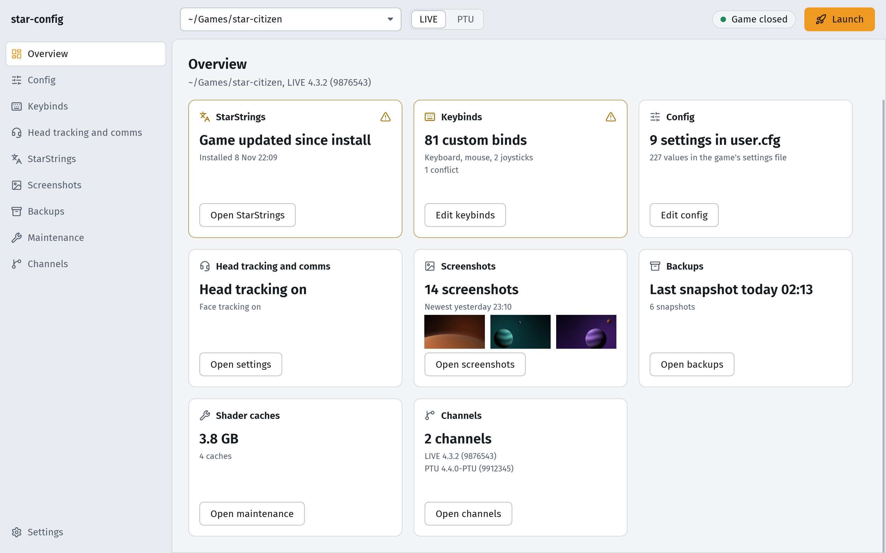
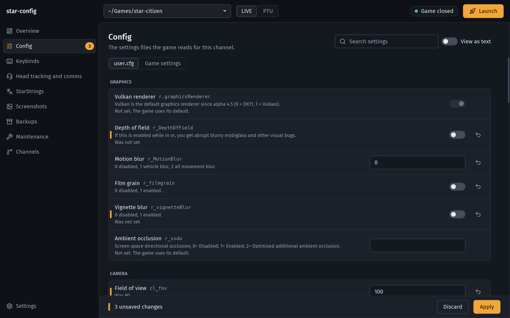
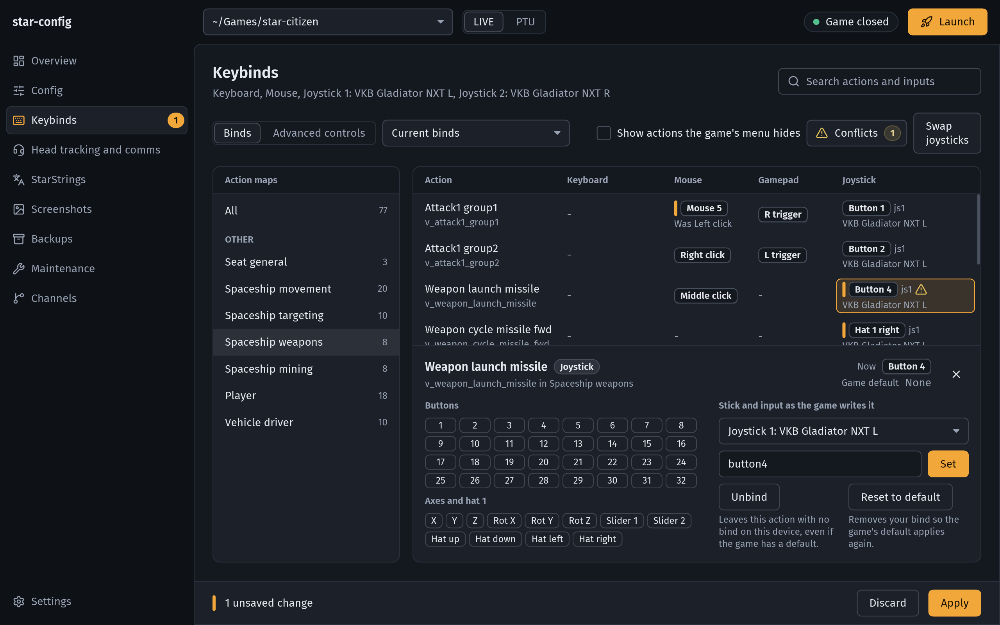
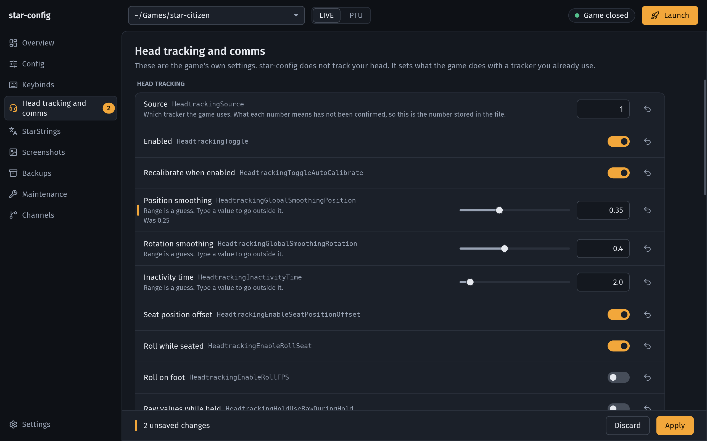
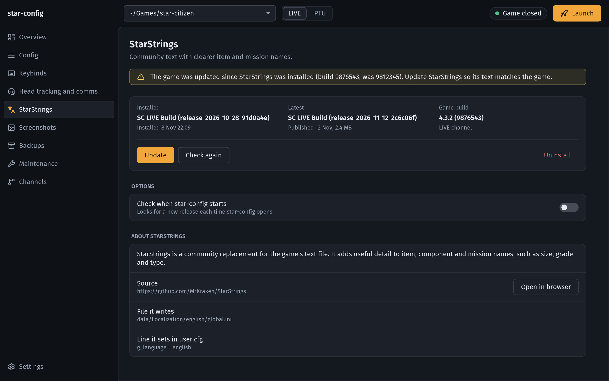
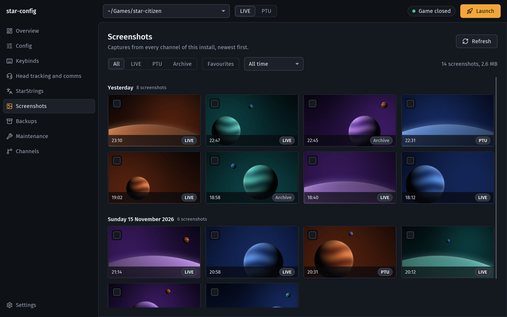
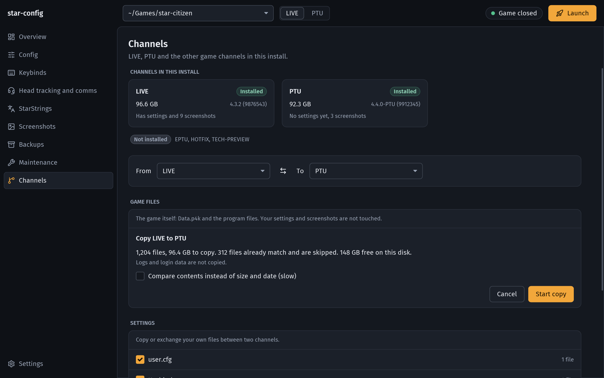
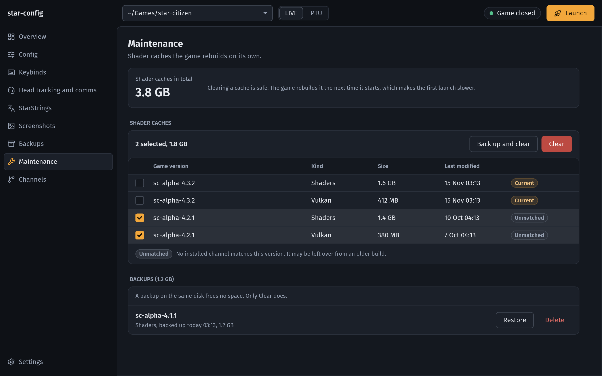
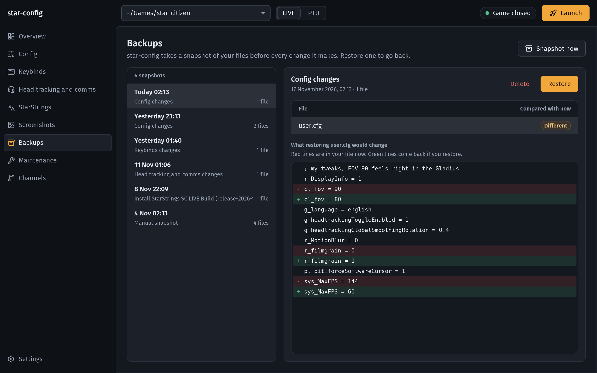

<!-- generated by readwright from README.md.j2; edit the template, not this file -->
# star-config

A desktop app for Linux and Windows that edits Star Citizen's settings files: user.cfg, keybinds, head tracking and comms, StarStrings, screenshots, shader caches and channels.

<picture>
  <source media="(prefers-color-scheme: dark)" srcset="docs/screenshots/overview-dark.png">
  <source media="(prefers-color-scheme: light)" srcset="docs/screenshots/overview-light.png">
  
</picture>

[](https://github.com/Garulf/star-config/actions/workflows/ci.yml) [](https://github.com/Garulf/star-config/releases/latest) [](https://github.com/Garulf/star-config/blob/main/LICENSE)

- [What it does](#what-it-does)
- [Installation](#installation)
- [Usage](#usage)
- [Development](#development)
- [Disclaimer](#disclaimer)
- [Contributing](#contributing)
- [License](#license)

## What it does

star-config finds your Star Citizen install (a Windows install, or a Wine prefix on Linux),
lets you pick a channel, and gives each kind of file its own screen.

| Screen | What you can do there |
|---|---|
| Overview | See the state of the install at a glance: StarStrings, binds, shader caches, last snapshot, what needs attention. |
| Config | Edit `user.cfg`, and every setting in the game's own menu under the menu's names and groups. Console variables star-config knows get a proper control for their type. Lines it does not know are kept as they are and can still be edited as text. |
| Keybinds | See every action the game has, with its in-game name and default bind beside yours, rebind by pressing the key or button, unbind, add a bind by action name, spot conflicts, swap joystick numbers, and edit exported layouts. Advanced controls covers inversion, exponents, response curves and deadzones per device. |
| Head tracking and comms | Change the game's own head tracking, VoIP and FOIP settings in `attributes.xml`. star-config does no tracking itself. |
| StarStrings | Install, update and remove [StarStrings](https://github.com/MrKraken/StarStrings), and see when a game patch means it needs reinstalling. |
| Screenshots | Browse captures from every channel by day, favourite, rename and archive them, and copy one to the clipboard at full size or shrunk to fit a chat upload limit. |
| Maintenance | Back up and clear shader caches. The top bar has a button that starts the RSI Launcher. |
| Channels | Copy the game files from one channel to another to skip a download, swap two channels, and copy or swap settings between them. |
| Backups | Every change star-config makes is snapshotted first. Compare a snapshot with the current files and restore it. |

| | |
| :---: | :---: |
|  |  |
| Config: staged changes to user.cfg | Keybinds: rebinding an action |
|  |  |
| Head tracking and comms | StarStrings |
|  |  |
| Screenshots | Channels: copying LIVE to PTU |
|  |  |
| Maintenance: shader caches | Backups: what a snapshot would change |

## Installation

Download the archive for your system from the
[latest release](https://github.com/Garulf/star-config/releases/latest) and unpack it anywhere.
There is no installer and nothing to set up.

| System | File | Run |
|---|---|---|
| Linux (x86_64) | `star-config-linux-x86_64.tar.gz` | `./star-config` |
| Windows (x86_64) | `star-config-windows-x86_64.zip` | `star-config.exe` |

On Linux the app needs a working Vulkan or OpenGL driver, which you already have if the
game runs. The folder picker goes through the desktop portal (`xdg-desktop-portal`).

### NixOS and Nix

The release tarball is linked for ordinary Linux and will not start on NixOS. The repository is
a flake, so use that instead.

Try it without installing:

```sh
nix run github:Garulf/star-config
```

Install it into your profile:

```sh
nix profile install github:Garulf/star-config
```

Or add it to a NixOS configuration (in Home Manager, put the same package in `home.packages`):

```nix
{
  inputs.star-config.url = "github:Garulf/star-config";

  # In a module that receives `inputs`:
  environment.systemPackages = [
    inputs.star-config.packages.${pkgs.stdenv.hostPlatform.system}.default
  ];
}
```

`overlays.default` adds `pkgs.star-config` if you prefer an overlay. Without flakes, `nix-build`
in a checkout builds the same package through `default.nix`.

The flake follows `nixos-unstable`. If you point it at your own nixpkgs with `follows`, that
nixpkgs needs Rust 1.95 or newer. The folder picker uses the desktop portal, so `xdg.portal`
must be enabled with a backend, which GNOME and Plasma already do.

### From source

You need Rust 1.95 or newer.

```sh
git clone https://github.com/Garulf/star-config.git
cd star-config
cargo build --release -p sc-app
./target/release/star-config
```

## Usage

1. Start star-config. It looks for the game in `Program Files\Roberts Space Industries` on every
   fixed disk on Windows, and in `~/Games/star-citizen` on Linux. If your install or Wine prefix
   is somewhere else, add its folder in Settings.
2. Pick the channel (LIVE, PTU, HOTFIX) in the top bar.
3. Change things. Edits are staged, not written. A bar at the bottom counts them and offers
   `Apply` and `Discard`.
4. Press `Apply`. star-config takes a snapshot, writes the files, and shows a toast with `Undo`.

Close the game before applying. While Star Citizen is running, star-config shows everything
read-only, because the game rewrites its own files on exit and would overwrite your changes.
Exported keybind layouts are the one exception, since the game only reads those on request.

### How it protects your files

- Nothing is written until you press `Apply`, and every apply snapshots the files it is about to touch.
- Files are replaced in one step (write to a temporary file, then rename), so a crash cannot leave half a file.
- If a file changed on disk after you opened it, your edits are replayed on the new version. A whole-file edit from the text view is held back and you are told, so it never silently replaces someone else's change.
- Lines, comments and settings that star-config does not understand are written back untouched.
- Swapping channels is journaled. If it is interrupted, the next start offers to finish or undo it.
- Deleted screenshots go to the system trash.
- `Data.p4k` is only ever read. Action names, default binds and the list of game settings come
  from your own copy, read once after each patch and cached per build. Nothing from the game
  ships with star-config. If it cannot be read, Keybinds and Config show only what your files
  hold until you press `Try again`.

Snapshots live under `~/.local/share/star-config` on Linux and `%APPDATA%\star-config` on
Windows. The Backups screen lists them and can prune old ones.

### What 0.1 does not do

- The Advanced controls axis table only edits deadzone and saturation lines your file already has.
- `Save as layout` copies an existing exported layout. It cannot yet turn your live profile into a new layout file. Export from the game first.
- No import or export of a whole setup as one file.
- The list of known `user.cfg` variables is short (40 for now). Anything else in your file still shows up and stays editable as text.
- It has been developed against sample files and a Linux build. Treat the first few applies on
  a real install with care and look at the Backups screen afterwards.

## Development

```sh
ICED_TEST_BACKEND=tiny-skia cargo test --workspace
cargo clippy --workspace --all-targets -- -D warnings
```

On NixOS, `nix develop` gives you a shell with the toolchain and the libraries the window
needs at run time.

The workspace has two crates. `crates/sc-core` holds all file, network and process logic and
has no UI code. `crates/sc-app` is the [iced](https://iced.rs) interface. UI tests run
headless with the software renderer, so they need no display.

Commits follow [Conventional Commits](https://www.conventionalcommits.org), and releases are
cut by release-please. `pre-commit install --hook-type pre-commit --hook-type pre-push` sets up
the hooks.

## Disclaimer

star-config is a fan project. It is not affiliated with or endorsed by Cloud Imperium Games
or Roberts Space Industries. Star Citizen is a trademark of Cloud Imperium Rights LLC.

## Contributing

Issues and pull requests are welcome at [Garulf/star-config](https://github.com/Garulf/star-config).

## License

MIT
